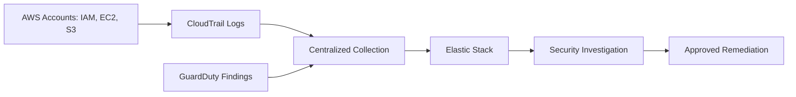

# AWS-Cloud-Security-Detection-Response
A proposed AWS security monitoring platform for detecting IAM misuse, suspicious permission changes, and S3 exposure risks.

## Technology Stack
AWS CloudTrail · GuardDuty · IAM · EC2 · S3 · Elastic Stack

## Proposed Architecture


## Security Use Cases
- Investigate unexpected IAM permission changes.
- Review GuardDuty findings for suspicious activity.
- Assess S3 access configurations for exposure risks.
- Document findings and proposed remediation.

## Example Commands
Requires an authenticated AWS CLI and appropriate read permissions.

```bash
# Review recent management events in the selected Region
aws cloudtrail lookup-events --max-items 10

# Discover GuardDuty detectors
aws guardduty list-detectors

# Inspect bucket-level public access blocking
aws s3api get-public-access-block --bucket YOUR_BUCKET_NAME
```

## Scope
These commands inspect existing AWS resources; they do not deploy the architecture. S3 public accessibility requires additional policy and account-level checks.
